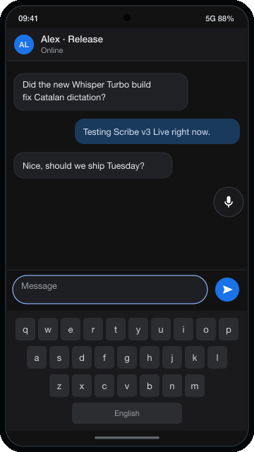

<p align="center">
  
</p>

# Phone Whisper

Fast streaming dictation for Android across apps—without replacing your keyboard.

<p align="center">
  
</p>

Tap the floating button to dictate in your default language, or long-press and slide onto a shortcut pill to switch language or toggle cleanup and screen context. Words stream live in a top preview bar while you speak, then insert straight into the focused Android text field when you tap stop.

If you try it and it genuinely saves you time, consider [sponsoring](https://github.com/sponsors/kafkasl).

## Highlights

- **Real-time cloud streaming**: Streams 16 kHz audio over WebSocket to **ElevenLabs Scribe v3 Live** (default) or **Google Gemini Live** (`gemini-3.5-transcribe-live`), showing live partial and locked words in a top bar as you speak.
- **Long-press language & mode shortcuts**: Quick tap runs your default preset (`EN`); long-press fans out wide shortcut pills (`ES`, `CA`, `NOTE`, plus an optional fourth slot). Each preset is configurable for badge, language, post-processing, and screen context.
- **Context-aware cleanup**: Optional Stage 2 polish via any OpenAI-compatible Chat Completions endpoint (defaults to Google Gemini `gemini-3.5-flash-lite`) using optional Accessibility screen context and text before the cursor to fix names, technical terms, and spoken self-corrections.
- **Offline resilience, cancel, and credit fallback**: Every recording streams simultaneously to a local WAV file on disk so network drops never lose speech. Cancel mid-recording or mid-polish anytime, retry failed clips inline or from **Saved recordings**, flag bad clips so they stay pinned, and automatically fall back to your local on-device model if cloud credits run out.
- **Local on-device mode (`sherpa-onnx`)**: Run completely offline with **Whisper Turbo** (multilingual EN/ES/CA), **Parakeet 0.6B v3** (EN/ES), **Moonshine v2 Base**, or **Parakeet 110M**.

## Why I built this

- I like SwiftKey and want to keep my existing keyboard.
- Built-in keyboard dictation felt inaccurate, and voice assistants that auto-submit prevent editing before sending.
- Streaming live text while speaking makes 1+ minute dictations feel instant, and optional context-aware post-processing fixes spelling, jargon, and self-corrections.
- Inserting directly into the field you are already using lets you keep editing like any other draft.

## Install

### Easiest: download the APK

Grab the latest APK from [GitHub Releases](https://github.com/kafkasl/phone-whisper/releases).

Open it on your phone, install it, then launch the app once to finish setup.

### Build from source

Requires JDK 17 and Android SDK.

```bash
git clone https://github.com/kafkasl/phone-whisper.git && cd phone-whisper
make build
```

APK output:

```bash
app/build/outputs/apk/debug/app-debug.apk
```

If you use ADB:

```bash
make adb-install
```

## How it works

1. A small overlay button floats on screen (drag it immediately to move it along either edge).
2. **Tap** once to start recording with your default preset, or **long-press and slide** onto a shortcut pill (`ES`, `CA`, `NOTE`) to pick another language or mode.
3. Live words stream in the top bar while you speak. Tap the red mic button again—or **Done** in the top bar—to finish, or tap **Cancel** (`×`) to abort.
4. If post-processing is enabled for that shortcut, a fast cleanup pass polishes the text before inserting it into the focused field (with **Use raw** and **Flag** actions on the confirmation pill).
5. If insertion is blocked by an app, the text is always copied to your clipboard. If your connection drops mid-speech, recording continues to disk and offers **Retry**, **Use partial**, or **Discard**.

## Setup

### First-time setup

1. Open **Phone Whisper**.
2. Grant the **Audio permission** and enable the **Accessibility service**.
3. Choose your transcription mode:
   - **Cloud streaming**: select **ElevenLabs** (default) or **Gemini Live**, and paste your own API key. Optionally configure the **Cleanup Model** (OpenAI-compatible base URL, model, and key) for post-processing.
   - **Local mode**: toggle **Use cloud streaming** off and download a local model (such as **Whisper Turbo**) directly in the app.
4. Customize **Shortcuts** (`Default tap` and `Long-press 1–4`) with your preferred languages, cleanup, and screen context settings.

## Why does it need Accessibility?

Phone Whisper uses Android Accessibility Service for two user-triggered actions only when you dictate:

1. **Inserting dictated text** into the currently focused text field across apps.
2. **Optional screen context** (configurable per shortcut, off by default on `NOTE`): reading visible text in the active window and draft text before the cursor—explicitly skipping password fields—so cleanup can fix names, technical terms, and capitalization.

It does **not** replace your keyboard, monitor browsing, or run background automation.

## Privacy

- **Local mode**: audio stays completely on-device.
- **Cloud mode**: audio streams directly from your device to your chosen provider (**ElevenLabs** or **Google Gemini**) using your own API key.
- **Optional cleanup**: when enabled on a shortcut, transcript text (plus optional non-password screen context) is sent directly from your device to your configured OpenAI-compatible endpoint.
- **Local recordings cache**: recent audio clips (last 10 unflagged plus any clips you explicitly flag) are stored privately in app storage for offline retry and review, and can be deleted anytime under **Saved recordings**.

I do not run a backend or relay server for this app.

Full policy: [PRIVACY.md](PRIVACY.md)

## Local models

Models are stored in app storage under:

```bash
/data/data/com.kafkasl.phonewhisper/files/models/
```

Current catalog (downloaded directly from `sherpa-onnx` release archives):

| Model | Size | Notes |
|---|---:|---|
| Whisper Turbo | 538 MB | Recommended default · Multilingual (EN, ES, CA) |
| Parakeet 0.6B v3 | 465 MB | Fast multilingual (EN, ES) |
| Moonshine v2 Base | 106 MB | Fast · English |
| Parakeet 110M | 100 MB | Lightweight · English |

If cloud mode detects an out-of-credits / quota error and a local model is installed, Phone Whisper automatically switches to your local model and transcribes the saved recording so no speech is lost.

## Development

```bash
make build       # build debug APK
make test        # run unit tests
make adb-install # build + install via ADB
make clean       # clean build artifacts
```

## App compatibility & limitations

- Works best in apps that expose standard Android text fields (`EditText`).
- Apps with custom input surfaces or restricted paste fall back to copying the transcript to the clipboard.
- Accessibility permission is required for cross-app insertion (and optional screen context).
- Cloud mode requires your own ElevenLabs, Gemini, or OpenAI-compatible API key.

## Support the project

If Phone Whisper saves you time, you can sponsor the project on GitHub:

- https://github.com/sponsors/kafkasl

## License

Personal project. Do whatever you want with it.
